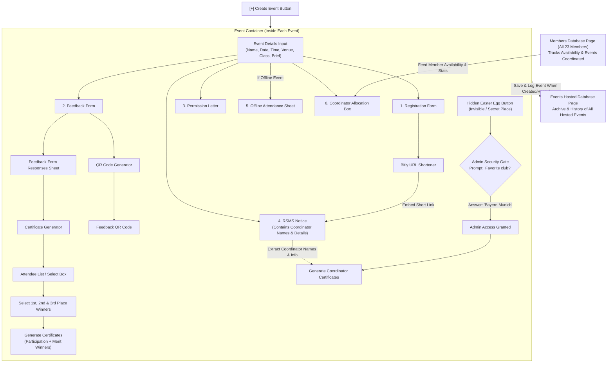

# System Architecture

## Architecture Flowchart

## Architectural Components

### 1. External Pages / Stores
- **Members Database Page (`/members`)**: Independent view listing all 23 team members, coordination history, and live availability status (`Free` / `Busy`).
- **Events Hosted Database Page (`/events`)**: Master registry storing metadata and records of every completed and upcoming event.

### 2. Event Container (`/events/[id]`)
Each event operates in an isolated container that encapsulates:
1. **Event Information Core**: Single source of truth (title, schedule, venue mode, class target, description).
2. **Registration Form Builder**: Standardized format with mandatory validation fields.
3. **Feedback Form Builder**: Collects post-event survey data and participant names.
4. **Permission Letter Generator**: Official template with dynamic placeholders for management approval.
5. **RSMS Notice Generator**: College circular generator with embedded Bitly shortened registration link.
6. **Offline Attendance Generator**: Conditional generator triggered only when the venue is physical/offline.
7. **Coordinator Allocation Box**: Picks assigned coordinators from the Members Database.

### 3. Service Modules
- **Bitly API Client**: Shortens registration URLs for easy SMS/notice readability.
- **QR Code Renderer**: Renders downloadable/projectable QR codes linked directly to the feedback form.
- **Certificate Engine**: Canvas/PDF rendering pipeline driven by feedback submission data and winner selections.
- **Admin Easter Egg**: Secret authenticated backdoor protected by security verification (`Favorite club?` -> `Bayern Munich`).

